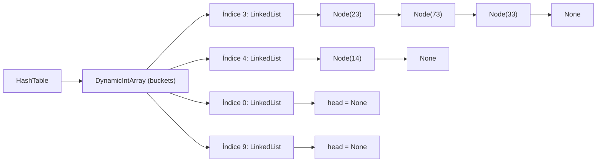

# Trabalho 08 — Tabela Hash com Encadeamento Separado (*Separate Chaining*)

Este documento explica detalhadamente a estrutura, o funcionamento e a implementação da **Tabela Hash (`HashTable`)** desenvolvida em [`trabalho08.py`](./trabalho08.py).

---

## 1. Visão Geral Conceitual

Uma **Tabela Hash (*Hash Table*)** é uma estrutura de dados projetada para realizar operações de **inserção**, **busca** e **remoção** em tempo médio constante — $O(1)$.

Para alcançar essa eficiência, ela utiliza uma **função de espalhamento (*função hash*)**, que transforma uma **chave** (`key`) em um **índice válido** (`idx`) de um vetor interno de compartimentos chamados ***buckets***.

### O Problema das Colisões e o *Chaining*
Como o universo de chaves possíveis (números inteiros quaisquer) é muito maior do que a capacidade do vetor (por padrão, `DEFAULT_CAPACITY = 10`), chaves distintas podem produzir o **mesmo índice**. Esse fenômeno é chamado de **colisão** (por exemplo: `33 % 10 == 3`, `73 % 10 == 3` e `23 % 10 == 3`).

Nesta implementação, as colisões são resolvidas por **Encadeamento Separado (*Separate Chaining*)**:
- Cada posição (*bucket*) do vetor armazena uma **Lista Encadeada Simples (`LinkedList`)**.
- Quando múltiplas chaves caem no mesmo índice, todas convivem pacificamente como nós encadeados dentro da lista daquele *bucket*.

---

## 2. Arquitetura das Classes

A solução é dividida em quatro classes que cooperam em camadas:



### 2.1. `Node`
Representa a unidade básica da lista encadeada:
- `self.data`: armazena a chave inserida.
- `self.next`: referência para o próximo `Node` na cadeia (ou `None` no fim da lista).

### 2.2. `LinkedList`
Gerencia os elementos que colidem em um mesmo *bucket*:
- **`append(value)`**: insere o novo nó **no início da lista (`head`)**:
  ```python
  new_node = Node(value)
  new_node.next = self.head
  self.head = new_node
  ```
  > **Por que inserir no início?** Inserir na cabeça da lista exige apenas reatribuir dois ponteiros, custando **$O(1)$ no pior caso**, sem precisar percorrer os elementos já existentes no *bucket*. Por isso, o último elemento inserido em um *bucket* aparece primeiro ao imprimir a lista.
- **`search(value)`**: percorre a lista a partir de `self.head` até encontrar `trav.data == value` (retornando `True`) ou chegar a `None` (retornando `False`).
- **`remove(value)`**: utiliza dois ponteiros (`prev` e `trav`) para localizar o valor e religar a lista:
  - Se o nó removido for o primeiro (`prev is None`), atualiza `self.head = trav.next`.
  - Se estiver no meio ou fim, faz `prev.next = trav.next`.
  - Retorna `True` se removeu o elemento ou `False` caso ele não exista.

### 2.3. `DynamicIntArray`
Encapsula um vetor de tamanho fixo (`self.capacity`, padrão `10`) que guarda os *buckets* da tabela hash, validando limites de acesso (`0 <= index < self.capacity`) nos métodos `get(index)` e `set(index, value)`.

---

## 3. Detalhamento da Classe `HashTable` e Métodos Implementados

### 3.1. Inicialização (`__init__`)
```python
def __init__(self, capacity=DEFAULT_CAPACITY):
    self.buckets = DynamicIntArray(capacity)
    # inicialize cada bucket como LinkedList
    for i in range(capacity):
        self.buckets.set(i, LinkedList())
```
Ao instanciar a `HashTable`, o vetor `self.buckets` é criado e **todas as posições são previamente preenchidas com objetos `LinkedList()` vazios**. Isso elimina verificações de `None` nos métodos seguintes: todo índice válido sempre contém uma lista pronta para receber chamadas de `append`, `search` e `remove`.

---

### 3.2. Função Hash (`_hash`)
```python
def _hash(self, key):
    # Define a Função Hash usando módulo da capacidade. Observe que Key é Chave e Index é o Valor.
    return key % self.buckets.capacity
```
- **Método da Divisão**: aplica a operação matemática de módulo:
  $$h(\text{key}) = \text{key} \bmod m$$
  onde $m$ é `self.buckets.capacity`.
- **Garantia de limites**: o resto da divisão por $m$ sempre resulta em um inteiro no intervalo $[0, m - 1]$, correspondendo exatamente aos índices válidos do `DynamicIntArray` (em Python, o operador `%` retorna valores não negativos mesmo para chaves negativas, ex.: `-7 % 10 == 3`).
- **Uso de `self.buckets.capacity`**: em vez de fixar `DEFAULT_CAPACITY`, consulta-se a capacidade real do array interno, permitindo instanciar tabelas de qualquer tamanho (`HashTable(capacity=20)`, por exemplo).
- **Relação Chave $\rightarrow$ Valor**: conforme destacado no comentário original do código, nesta modelagem a chave fornecida pelo usuário é `key`, enquanto o "valor" associado pela tabela e consultado na busca é o próprio **índice (`idx`)** do *bucket* onde a chave foi alocada.

---

### 3.3. Inserção (`insert`)
```python
def insert(self, key):
    idx = self._hash(key)
    bucket = self.buckets.get(idx)
    bucket.append(key)
```
**Passo a passo da execução:**
1. Calcula o índice de destino `idx` por meio de `self._hash(key)`.
2. Acessa em $O(1)$ a `LinkedList` correspondente àquele índice via `self.buckets.get(idx)`.
3. Delega a inserção para `bucket.append(key)`, que adiciona o novo nó na cabeça da lista em $O(1)$.

> **Observação sobre chaves duplicadas:** Seguindo a formulação clássica de *Chained-Hash-Insert* (como em Cormen et al., *Algoritmos / CLRS*) e o padrão de delegação direta usado em `remove`, o método `insert` insere diretamente no início da lista para preservar o custo estrito $O(1)$. Caso se desejasse impedir chaves repetidas (comportamento de conjunto/*Set*), bastaria verificar `if not bucket.search(key): bucket.append(key)`, trocando a inserção $O(1)$ no pior caso por uma varredura prévia do *bucket* em $O(1 + \alpha)$ no caso médio.

---

### 3.4. Busca (`search`)
```python
def search(self, key):
    idx = self._hash(key)
    bucket = self.buckets.get(idx)
    if bucket.search(key):
        return idx
    return None
```
**Passo a passo da execução:**
1. Calcula o índice `idx = self._hash(key)` onde a chave **obrigatoriamente** estaria caso tenha sido inserida (não é necessário procurar em nenhum outro *bucket*).
2. Recupera a `LinkedList` daquele índice com `self.buckets.get(idx)`.
3. Executa `bucket.search(key)` para percorrer apenas os nós encadeados naquele *bucket*:
   - Se retornar `True`, devolve `idx` (o índice do *bucket* onde o elemento foi encontrado).
   - Se retornar `False`, devolve `None`, sinalizando que a chave não existe na tabela.

> **Detalhe importante sobre o retorno `0` vs `None`:** Quando uma chave cai no índice `0` (por exemplo, `key = 20` com capacidade `10`), `search(20)` retorna `0`. Em Python, `bool(0)` é `False`, por isso o código de teste utiliza corretamente `if idx is not None:` em vez de `if idx:`. Retornar `None` quando não encontrado permite distinguir sem ambiguidade o índice `0` de um elemento inexistente.

---

### 3.5. Remoção (`remove`)
```python
def remove(self, key):
    idx = self._hash(key)
    bucket = self.buckets.get(idx)  # pega a LinkedList daquele índice
    return bucket.remove(key)       # delega tudo para a LinkedList
```
Segue exatamente o mesmo fluxo: descobre o *bucket* via `_hash(key)`, obtém a `LinkedList` correspondente e delega a remoção do nó a `bucket.remove(key)`, retornando `True` em caso de sucesso ou `False` se a chave não estava presente.

---

## 4. Rastreamento Passo a Passo do Bloco de Testes (`__main__`)

Considere `ht = HashTable()` com `capacity = 10` (índices `0` a `9` inicialmente vazios):

### Passo 1: Inserções (`33`, `14`, `7`, `73`, `23`)
| Operação | Cálculo de `_hash(key)` | Índice (`idx`) | Evolução da `LinkedList` no *bucket* `idx` |
| :--- | :---: | :---: | :--- |
| `ht.insert(33)` | `33 % 10` | `3` | `33` |
| `ht.insert(14)` | `14 % 10` | `4` | `14` |
| `ht.insert(7)` | `7 % 10` | `7` | `7` |
| `ht.insert(73)` | `73 % 10` | `3` *(colisão!)* | `73 -> 33` *(inserido no início)* |
| `ht.insert(23)` | `23 % 10` | `3` *(colisão!)* | `23 -> 73 -> 33` *(inserido no início)* |

### Passo 2: Buscas (`14`, `23`, `19`)
- **`ht.search(14)`**: `_hash(14) = 4`. No *bucket* `4`, encontra `14` logo em `head` $\rightarrow$ retorna `4`.
- **`ht.search(23)`**: `_hash(23) = 3`. No *bucket* `3` (`23 -> 73 -> 33`), encontra `23` logo em `head` $\rightarrow$ retorna `3`.
- **`ht.search(19)`**: `_hash(19) = 9`. O *bucket* `9` está vazio (`head = None`) $\rightarrow$ `bucket.search(19)` é `False` $\rightarrow$ retorna `None`.

### Passo 3: Remoções (`73` e `35`) e Nova Busca (`73`)
- **`ht.remove(73)`**: `_hash(73) = 3`. No *bucket* `3` (`23 -> 73 -> 33`), percorre `23`, acha `73` e ajusta o ponteiro `Node(23).next = Node(33)`. O *bucket* `3` passa a ser `23 -> 33` e retorna `True` (`Sucesso`).
- **`ht.remove(35)`**: `_hash(35) = 5`. O *bucket* `5` está vazio $\rightarrow$ retorna `False` (`Falha`).
- **`ht.search(73)`**: `_hash(73) = 3`. Percorre `23 -> 33`, não encontra `73` $\rightarrow$ retorna `None`.

### Saída Completa no Terminal
```text
Estado da Hash Table após inserções:
0:  
1:  
2:  
3: 23 -> 73 -> 33
4: 14
5:  
6:  
7: 7
8:  
9:  
Buscar 14: encontrado no índice 4
Buscar 23: encontrado no índice 3
Buscar 19: elemento não existe
Remover 73: Sucesso
Remover 35: Falha
Buscar 73 após remoção: elemento não existe

Estado final da Hash Table:
0:  
1:  
2:  
3: 23 -> 33
4: 14
5:  
6:  
7: 7
8:  
9:  
```

---

## 5. Análise de Complexidade

Seja $m$ a capacidade da tabela (`capacity`, número de *buckets*) e $n$ a quantidade total de elementos armazenados. Define-se o **fator de carga (*load factor*)** como:

$$\alpha = \frac{n}{m}$$

Sob a hipótese de espalhamento uniforme simples, cada *bucket* possui em média $\alpha$ elementos:

| Método / Operação | Caso Médio | Pior Caso (todas as $n$ chaves colidem no mesmo *bucket*) | Espaço Auxiliar por Operação |
| :--- | :---: | :---: | :---: |
| `__init__(capacity)` | $\Theta(m)$ | $\Theta(m)$ | $\Theta(m)$ *(estrutura base)* |
| `_hash(key)` | $\Theta(1)$ | $\Theta(1)$ | $\Theta(1)$ |
| `insert(key)` | $\Theta(1)$ | $\Theta(1)$ | $\Theta(1)$ *(1 novo `Node`)* |
| `search(key)` | $\Theta(1 + \alpha)$ | $\Theta(n)$ | $\Theta(1)$ |
| `remove(key)` | $\Theta(1 + \alpha)$ | $\Theta(n)$ | $\Theta(1)$ |

Quando a capacidade $m$ é proporcional ao número de elementos $n$ ($\alpha = O(1)$), todas as operações principais (`insert`, `search` e `remove`) executam em **tempo médio constante $O(1)$**, enquanto o espaço total ocupado pela estrutura é $\Theta(m + n)$.
